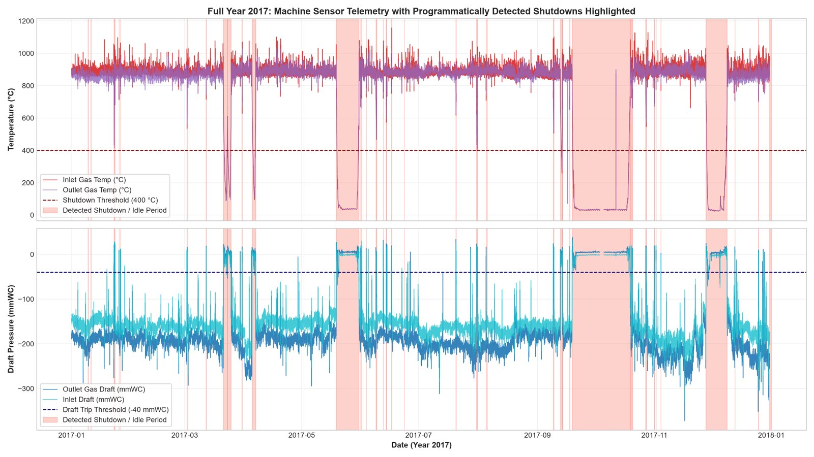
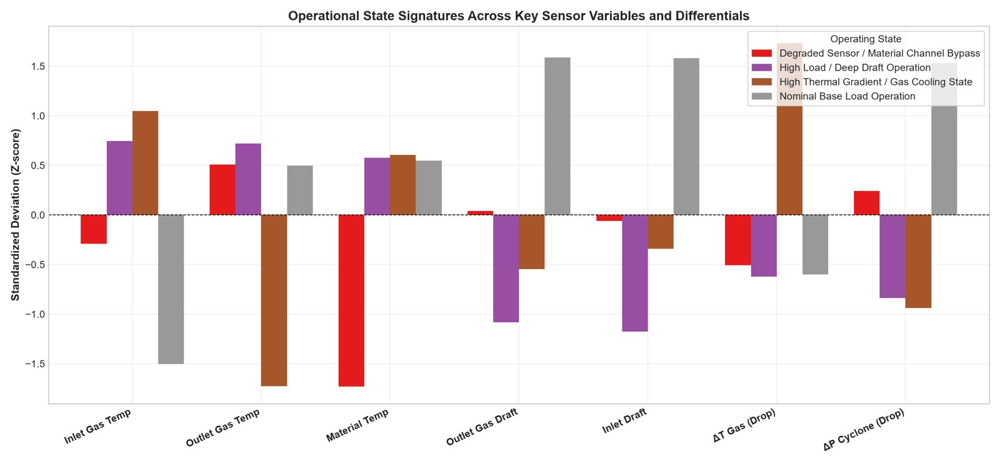
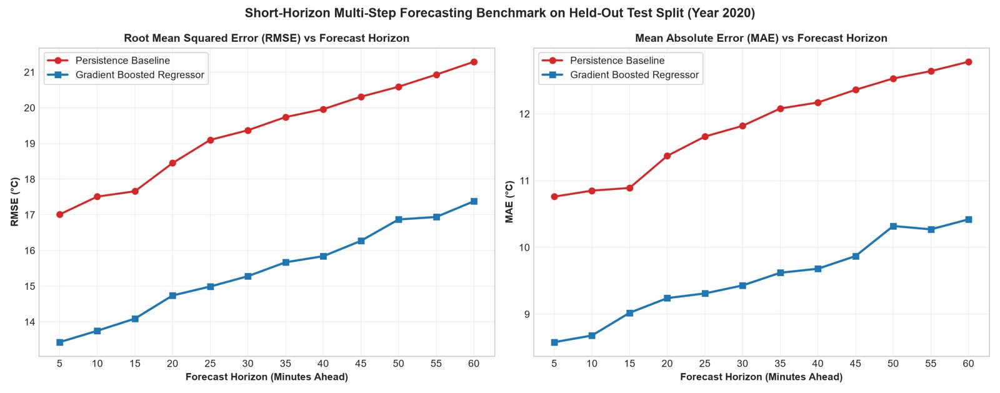
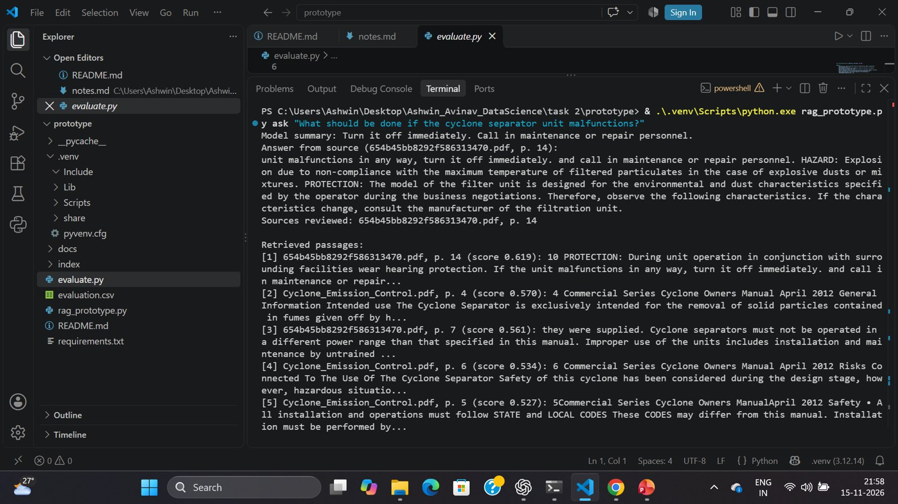

# Cyclone Analytics and Document Q&A

A Python project combining machine learning for industrial sensor analysis with a local retrieval-augmented generation (RAG) prototype for technical documents.

## Project overview

- **Machine learning:** prepares time-series data, detects shutdowns, groups active operating states with K-means, finds state-specific anomalies with Isolation Forest, and compares gradient-boosted temperature forecasts with a persistence baseline.
- **Generative AI and RAG:** extracts and chunks PDF text, indexes embeddings with FAISS, combines semantic and keyword retrieval, and uses a locally run instruction model to produce cited answers. A fallback handles weak retrieval, and simple rules filter selected sensitive requests.

## Repository structure

```text
machine_analysis/
  task1_analysis.py       Sensor analysis pipeline
  requirements.txt        Analysis dependencies
document_qa/
  rag_prototype.py        PDF indexing and question answering
  requirements.txt        RAG dependencies
```

The original dataset, input PDFs, and generated indexes are not included. Selected plots and a sample answer from the original run are shown below. To run the code, supply data and documents you have permission to use. The two pipelines were developed for a specific dataset and document corpus; results and thresholds may need adjustment for other inputs.

## Example results

These figures show results from the original analysis; the underlying input data is not included.

### Shutdown detection



### Operating states



### Forecast comparison



### RAG answer with source citation



The example answer was produced from the original document collection, which is not included in this repository.

## Machine analysis

Use Python 3.12 and install dependencies in a virtual environment:

```powershell
cd machine_analysis
python -m venv .venv
.\.venv\Scripts\python.exe -m pip install -r requirements.txt
```

Place a compatible dataset in this folder as `data.xlsx`, `data.csv`, or `data_raw.parquet`, then run:

```powershell
.\.venv\Scripts\python.exe task1_analysis.py
```

The analysis expects a timestamp and six cyclone sensor columns; inspect `load_and_inspect_raw_data` and the script's preprocessing code for the expected schema. It writes CSV reports and plots to the same folder. The fixed dates and thresholds reflect the original analysis and need review when using other data. Dataset-specific case study code is omitted from this public version.

## Document Q&A

In a separate virtual environment:

```powershell
cd document_qa
python -m venv .venv
.\.venv\Scripts\python.exe -m pip install -r requirements.txt
```

Create a `docs` folder and place text-extractable PDFs in it. Then run:

```powershell
.\.venv\Scripts\python.exe rag_prototype.py inspect
.\.venv\Scripts\python.exe rag_prototype.py index
.\.venv\Scripts\python.exe rag_prototype.py ask "What maintenance checks are recommended?"
```

The first run downloads the free models `sentence-transformers/all-MiniLM-L6-v2` and `Qwen/Qwen2.5-0.5B-Instruct` from Hugging Face. No paid API is required. Rebuild the index after changing the PDFs. The first download requires an internet connection and disk space.

## Limitations

PDFs with scanned or poorly extracted pages may need OCR. The answer model is small and can omit details; review the cited passages. Similarity thresholds and the input filter are simple prototype guardrails, not guarantees of relevance, privacy, or safety. The scaling architecture is a proposal and has not been load tested.

